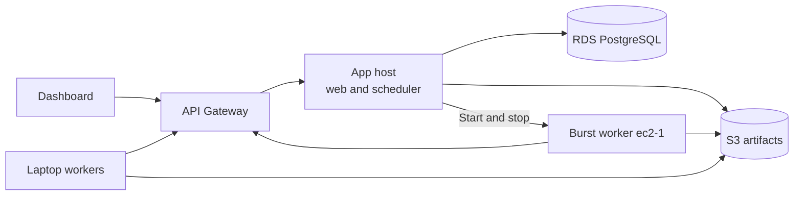

# AWS-hosted scheduler

The `us-east-1` control plane stays available with the lab laptop disconnected. A private app host serves the dashboard and REST API, and a second service on that host ranks the queue and starts or stops one EC2 burst worker. PostgreSQL is the queue. The burst worker stays stopped until a placement can still meet the deadline inside the job budget and the run budget. The laptop supplies two optional Docker slots, `local-1` and `local-2`.

Open the [hosted dashboard](https://4k3efjo42g.execute-api.us-east-1.amazonaws.com/), the `DashboardUrl` output of `ucs531-qos-hosted-gateway`. `GET /api/health` on that hostname checks that the API can read the jobs table. The laptop lab stack, with assumed role sessions and a Systems Manager relay, is a separate procedure in [aws/README.md](README.md).

## Layout

Browsers and workers call the public HTTPS API. API Gateway forwards each request through a VPC link and a Cloud Map registration to the app host on port 3000. The app instance has no public IPv4 address.



These four stages reuse `ucs531-qos-resources` (the burst instance, artifact bucket, and ECR repository) and `ucs531-qos-observability` (the `/ucs531/scheduler` log group and alarms). The `ucs531-qos` profile must belong to the same account as the resource stack.

| Stage | Stack | What it adds |
|---|---|---|
| Data | `ucs531-qos-hosted-data` | VPC `10.53.0.0/16`, app subnet `10.53.1.0/24`, database subnets `10.53.10.0/24` and `10.53.11.0/24`, egress-only IPv6, an S3 gateway endpoint, encrypted single-AZ `db.t4g.micro` PostgreSQL 17.11, and three Secrets Manager secrets |
| App | `ucs531-qos-hosted-app` | Private `t3.small` origin, project instance profile, application image pointer, and CloudWatch streams `app-web` and `app-scheduler` |
| Gateway | `ucs531-qos-hosted-gateway` | HTTPS API hostname, private VPC link, Cloud Map origin registration, and a CloudWatch access log |
| Worker | `ucs531-qos-hosted-worker` | A grant to read the burst worker token, and a Systems Manager document that binds `ec2-1` to the hosted URL |

RDS is encrypted, has no public endpoint, and accepts PostgreSQL from the app security group. Before the app starts, `qos-hosted-prepare` checks the database hostname with `sslmode=verify-full` against `aws/certs/rds.pem`, creates or updates the `scheduler_app` role, and applies `db/*.sql`. `qos-hosted@web` and `qos-hosted@scheduler` then start, and systemd restarts them on failure. Secret files for that boot are root-readable and live in `/run/qos-hosted`.

The data stack stores three secrets: the RDS master password, a 64-character `RuntimeSeed`, and a 48-character `BurstWorkerToken`. Dashboard and laptop-worker credentials are HMAC-SHA256 values of `ucs531/hosted/v1/{session,operator,student,local-1,local-2,database}` under that seed. `aws/use-hosted.ps1` reads the seed and emits only the value for the mode you asked for. The burst worker uses `BurstWorkerToken` on its own.

Workers reach the queue through the HTTPS API. Artifact reads and writes use short-lived S3 URLs scoped to one input or one attempt output. The dashboard downloads the verified result through the same authenticated API. Registration for `ec2-1` must present an Instance Identity Document for this account, region, and instance, and the image digest must match the pin. The burst instance requires IMDSv2 with hop limit 1. [API Gateway private integrations](https://docs.aws.amazon.com/apigateway/latest/developerguide/http-api-develop-integrations-private.html)

## Sign in

Paste the token into **Project access token**. `Operator` can open Operations, start and finish runs, and read metrics. `Student` can submit, track, and download that account's jobs.

```powershell
./aws/use-hosted.ps1 -Mode Operator -Profile ucs531-qos
./aws/use-hosted.ps1 -Mode Student -Profile ucs531-qos
```

The scripts use `aws` from `PATH`. For the per-user AWS CLI on this laptop, pass `-Aws` with `Join-Path $env:LOCALAPPDATA 'Programs\Amazon\AWSCLIV2\aws.exe'`.

## Optional laptop workers

Prepare `.env.aws-workers` once, then start Compose when the laptop should contribute capacity. Git ignores `.env.aws-*`. A later start can reuse the cached image and the tokens in that file. Refresh the ECR login before pulling an image that is not cached. Each slot defaults to one CPU through `LOCAL_WORKER_CPUS`.

```powershell
./aws/use-hosted.ps1 -Mode Workers -Profile ucs531-qos
docker compose --env-file .env.aws-workers -f compose.workers.yaml up -d
docker compose --env-file .env.aws-workers -f compose.workers.yaml stop
```

Stopping the containers leaves the dashboard, API, queue, and scheduler running. A job whose budget covers the reservation can still be placed on `ec2-1`. A zero-budget job stays queued with the local-worker waiting reason until a laptop slot is free.

## Publish images

Publish the `hosted` and `worker` Dockerfile targets to the private ECR repository before the App and Worker stages. The repository uses immutable tags, so a changed build needs a new tag. The App stage takes both digests: the hosted image runs the control plane, and the worker digest is the pin checked at EC2 registration.

```powershell
$region = 'us-east-1'
$profile = 'ucs531-qos'
$repo = aws cloudformation describe-stacks --region $region --profile $profile --stack-name ucs531-qos-resources --query "Stacks[0].Outputs[?OutputKey=='ImageRepository'].OutputValue | [0]" --output text
$registry, $repository = $repo -split '/', 2
$tag = git rev-parse --short HEAD
aws ecr get-login-password --region $region --profile $profile | docker login --username AWS --password-stdin $registry
docker build --platform linux/amd64 --target hosted -t "${repo}:hosted-$tag" .
docker build --platform linux/amd64 --target worker -t "${repo}:worker-$tag" .
docker push "${repo}:hosted-$tag"
docker push "${repo}:worker-$tag"
$appDigest = aws ecr describe-images --region $region --profile $profile --repository-name $repository --image-ids "imageTag=hosted-$tag" --query 'imageDetails[0].imageDigest' --output text
$workerDigest = aws ecr describe-images --region $region --profile $profile --repository-name $repository --image-ids "imageTag=worker-$tag" --query 'imageDetails[0].imageDigest' --output text
```

## Provision

Run the stages from the repository root. The gateway hostname exists only after the Gateway stage, and a browser write is accepted when its `Origin` matches `PUBLIC_ORIGIN`. The first App deploy can omit that hostname. The second App deploy records the gateway URL. On every later App deploy, pass the same `-RateDate` and `-RateUsdPerHour` used for the running evaluation. The script otherwise stamps today's date and `$0.0208` per hour.

```powershell
./aws/deploy-hosted.ps1 -Stage Data
./aws/deploy-hosted.ps1 -Stage App -AppDigest $appDigest -WorkerDigest $workerDigest -RateDate $rateDate -RateUsdPerHour 0.0208
./aws/deploy-hosted.ps1 -Stage Gateway
$url = aws cloudformation describe-stacks --region us-east-1 --profile ucs531-qos --stack-name ucs531-qos-hosted-gateway --query "Stacks[0].Outputs[?OutputKey=='DashboardUrl'].OutputValue | [0]" --output text
./aws/deploy-hosted.ps1 -Stage App -AppDigest $appDigest -WorkerDigest $workerDigest -PublicOrigin $url -RateDate $rateDate -RateUsdPerHour 0.0208
./aws/deploy-hosted.ps1 -Stage Worker -WorkerDigest $workerDigest
./aws/bind-hosted-worker.ps1
```

User data writes `/etc/qos-hosted/app.env` at instance launch. An instance that is already running keeps its current file when the stack updates. After the second App deploy, set `PUBLIC_ORIGIN` in that file to `$url` through Systems Manager and restart `qos-hosted@web`. After an app digest change, restart `qos-hosted-prepare`, then `qos-hosted@web` and `qos-hosted@scheduler`, while the queue is idle. Prepare reads the digest from its SSM parameter, pulls the image when it is missing locally, refreshes runtime credentials, and applies migrations.

The Gateway stage also updates the data stack with CloudFront ingress turned off, matching an API Gateway entry. Cookies, authorization, query strings, and upload methods pass through the proxy.

## Burst worker

`bind-hosted-worker.ps1` continues only when the burst instance is stopped. It stops `qos-hosted@scheduler`, starts the instance, runs the worker stack's `BindDocument`, stops the instance, and starts the scheduler again. The document sets `WORKER_API_URL` to the hosted dashboard URL, pins the worker image, and installs a boot hook that reads `BurstWorkerToken` into `worker.env`.

On a later boot, `prepare-worker.sh` checks that digest and loads the identity document from IMDSv2. The worker container runs read-only, with every capability dropped, and logs to the `ec2-1` CloudWatch stream. The host watchdog powers the instance off if controller contact lapses. The scheduler asks EC2 to stop the instance after it has been idle. Each boot then calls the hosted HTTPS API directly. The relay in [aws/README.md](README.md) belongs to the lab stack.

## CloudFront

CloudFront requires AWS Support to verify this project account before it can create a distribution. After verification, `-Stage Edge` deploys `ucs531-qos-hosted-edge`: a private VPC origin, caching disabled, and viewer headers and cookies forwarded. That stage also restores CloudFront ingress on the data stack and records the origin security group. [CloudFront private origins](https://docs.aws.amazon.com/AmazonCloudFront/latest/DeveloperGuide/private-content-vpc-origins.html)

Point the app and the workers at the edge hostname afterward. Laptop workers need another `use-hosted.ps1 -Mode Workers -Entrypoint Edge` so `.env.aws-workers` picks up the new URL.

```powershell
./aws/deploy-hosted.ps1 -Stage Edge
$url = aws cloudformation describe-stacks --region us-east-1 --profile ucs531-qos --stack-name ucs531-qos-hosted-edge --query "Stacks[0].Outputs[?OutputKey=='DashboardUrl'].OutputValue | [0]" --output text
./aws/deploy-hosted.ps1 -Stage App -AppDigest $appDigest -WorkerDigest $workerDigest -PublicOrigin $url -RateDate $rateDate -RateUsdPerHour 0.0208
./aws/deploy-hosted.ps1 -Stage Worker -WorkerDigest $workerDigest -Entrypoint Edge
./aws/bind-hosted-worker.ps1
```

Update `/etc/qos-hosted/app.env` on the existing app host the same way as a gateway origin change, then restart `qos-hosted@web`.

## Cost estimate

Standard `us-east-1` rates for uninterrupted use over a 730-hour month, before credits. The EC2 burst instance stays stopped when idle, so its compute is usage on top of this floor.

| Resource | Estimated monthly cost |
|---|---:|
| `t3.small` app host at $0.0208/hour | $15.18 |
| Single-AZ `db.t4g.micro` PostgreSQL at $0.016/hour | $11.68 |
| 20 GB of RDS gp3 storage and two 12 GB EC2 gp3 volumes | About $4.22 |
| Three Secrets Manager secrets | About $1.20 plus requests |
| API Gateway, Cloud Map, CloudWatch, S3, ECR, and burst runs | Varies with usage |

Budget roughly $33–36 per month for a lightly used demo before credits. AWS Free plan credits cover eligible usage until the credits are depleted or the plan expires. Keeping the app available after that point requires an account decision by the owner. [EC2 pricing](https://aws.amazon.com/ec2/pricing/on-demand/) · [RDS PostgreSQL pricing](https://aws.amazon.com/rds/postgresql/pricing/) · [Secrets Manager pricing](https://aws.amazon.com/secrets-manager/pricing/) · [AWS Free plan](https://docs.aws.amazon.com/awsaccountbilling/latest/aboutv2/free-tier-plans.html)

## Live acceptance on November 25, 2026

`scripts/verify-hosted.ts` checks the hosted API in three phases: `connected`, `offline`, and `restart`. The classroom walkthrough is [docs/submission/demo.md](../docs/submission/demo.md).

| Scenario | Observed result | Evidence |
|---|---|---|
| Hosted sign-in, CSV upload, and download | Signed in, submitted, and downloaded the result in Brave. `local-1` finished before the deadline. The saved 250 Hz JSON matched the winning attempt's SHA-256. | [Browser-submitted job](https://4k3efjo42g.execute-api.us-east-1.amazonaws.com/?job=87f392a7-6f8e-422a-a47e-8dfafa009364) |
| Both local slots busy | QoS selected EC2 to rescue the deadline. EC2 was ready after 17.3 seconds. The result was published 64.5 seconds before the deadline, and the worker stopped after idling. | [Burst job](https://4k3efjo42g.execute-api.us-east-1.amazonaws.com/?job=8191eab0-45bd-4450-bfa4-680d06d8ce1c) |
| Laptop execution disconnected | The original lab app, relay, and both laptop worker slots were offline. EC2 was ready after 19.3 seconds and completed the cloud-eligible job. The zero-budget job stayed queued with the local-worker waiting reason. | [EC2 result](https://4k3efjo42g.execute-api.us-east-1.amazonaws.com/?job=52a25224-599f-4e02-b9e4-7c4e888b1812), [zero-budget job](https://4k3efjo42g.execute-api.us-east-1.amazonaws.com/?job=641edf4a-5adb-4ad4-bdc4-fe31929e0e38) |
| App restart and database privacy | Both AWS services restarted after their containers were killed. Earlier job records and result checksums still matched through HTTPS. AWS reported encrypted RDS with public access disabled and inbound PostgreSQL limited to the app security group. | Local acceptance artifacts `app-restart.json`, `restart.json`, and `aws-state.json` |

The two EC2 runs matched the worker and controller CloudWatch streams on the attempt IDs, pinned image digest, result checksum, deadline outcome, and stop events. Raw JSON evidence is in the local `evaluation-output/hosted/` directory. The connected run used a 0.035 CPU quota per laptop worker to keep the burst reproducible. The default worker-only Compose command uses one CPU per worker.
