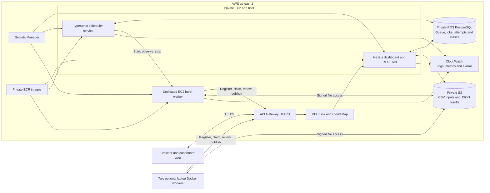
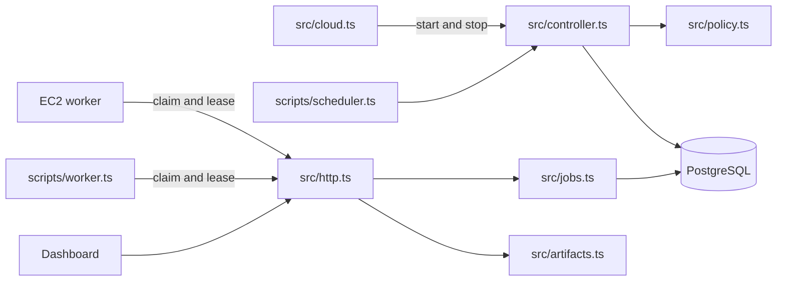

# Deployed System Architecture

Clients enter through a public HTTPS API in `us-east-1`. The app host has no public IPv4 address. API Gateway forwards each request through a VPC link and Cloud Map to that host on port 3000. PostgreSQL and S3 stay private. The burst worker stays stopped until the scheduler starts it.

## Two processes, one queue

The web process answers short requests: sign-in, submit, upload, status, and download. The scheduler process is the only loop that ranks the queue and starts or stops EC2. Both run on the private app host as separate services, `qos-hosted@web` and `qos-hosted@scheduler`, and both read and write PostgreSQL. Workers never open the database. A laptop worker and the EC2 worker claim through the same HTTPS routes.

Writes from the API and the controller share one transaction lock, `pg_advisory_xact_lock(531, 1)`. Each scheduler tick takes a separate try-lock, `pg_try_advisory_lock(531, 2)`, and skips the tick when another tick still holds it. That keeps one placement decision in flight.

## What a job passes through

`src/jobs.ts` owns the transitions. The HTTP response admits the job. Completion still has to pass through the queue, a fenced attempt, and a verified artifact.

| State | How the job gets there |
|---|---|
| `AWAITING_INPUT` | `POST /api/jobs` with an `Idempotency-Key` |
| `QUEUED` | The CSV matches `inputSha256`, fits the upload window, and passes the sample checks |
| `ASSIGNED` | The scheduler commits the job to one free slot |
| `RUNNING` | The worker starts the attempt |
| `SUCCEEDED` | The API recomputes the output SHA-256 and it matches the worker's checksum |
| `FAILED` | The upload window elapsed, the queue wait elapsed, the input was invalid, or the single retry was already spent |

A transient failure before the second attempt returns the job to `QUEUED`. `invalid_input` fails the job immediately. The upload window is 10 minutes. A queued job that waits 15 minutes fails. An attempt that stays silent for 20 seconds loses its lease.

The worker runs the analysis in a child process, `scripts/compute.ts`, so a bad file cannot take down the claim loop. The only job type is `vibration-v1`. The child reads the CSV from stdin and writes frequency, best lag, and lag scores to stdout.

## How a slot is chosen

`rankJobs` orders the queue. `placeJob` picks `local` or `ec2` and stores both finish forecasts.

| Policy | Queue order |
|---|---|
| `fcfs` | Oldest `queuedAt`, then job id |
| `priority` | `high`, then `normal`, then `low`, then the FCFS order |
| `qos` | A job that has waited at least `ageMs` (120 seconds) moves ahead. Otherwise priority, then the latest start that can still be local, then FCFS |

Service time is scaled compute, bytes divided by target throughput, plus a fixed overhead. A cold EC2 start adds the startup allowance before the reservation is priced. The forecast includes work already on each slot and earlier jobs in policy order.

QoS selects local with reason `local_meets_deadline` when the local forecast is on time. It selects EC2 with reason `cloud_rescues_deadline` when the cloud forecast is on time and both budgets can cover the reservation. Cloud is refused with `cloud_unavailable`, `job_budget`, or `run_budget` when the slot is missing or the remaining money cannot cover the reservation. FCFS and priority may still select EC2 when it becomes free sooner than a busy local slot (`cloud_starts_earlier`).

## What PostgreSQL remembers

| Record | What it holds |
|---|---|
| Run | One active policy, calibration, and budget. A partial unique index allows a single open run. |
| Job | Owner, idempotency key, request hash, microdollar budget, spent and reserved amounts, status, and the decision JSON |
| Attempt | Target, worker, generation, lease end, outcome, and output SHA-256. Number starts at 1. |
| Worker | Slot id, generation UUID, target, and last heartbeat |
| Capacity session | EC2 start through stop: requested, running, ready, idle, stop requested, stopped |
| Event | Append-only timeline for the job detail view |

One slot holds one `ASSIGNED` or `RUNNING` job. One cloud session is open at a time. Inputs live at `inputs/{jobId}/recording.csv`. Outputs live at `attempts/{jobId}/{attemptId}.json`. S3 writes use `IfNoneMatch: *`.

## Who may cross the boundary

The browser signs in with an operator or student token. A student sees that account's jobs. Run start, finish, Operations, and metrics require the operator flag. Cookie writes must come from the configured public origin.

Each worker process boots with a new generation UUID. A stale generation inside the lease window is rejected, so a restarted daemon cannot finish another process's attempt. `ec2-1` also presents an Instance Identity Document. The API checks the RSA-SHA256 signature, then the account, region, instance id, and pinned image digest. The instance requires IMDSv2 with hop limit 1.

Artifact URLs are short-lived and scoped to one input or one attempt output. The dashboard downloads the verified result through the authenticated API. The app connects to RDS with `sslmode=verify-full` and the bundled `us-east-1` certificate. Secret files for a boot live in `/run` and are root-readable.

On the burst host, the worker container runs read-only with every capability dropped. A watchdog powers the instance off if controller contact lapses. The scheduler stops the instance after it has been idle for `idleMs` (60 seconds). A new cloud start waits out `cooldownMs` (120 seconds). Startup that exceeds `startupMs` (90 seconds) is recorded as `cloud_startup_timeout`.

The stack inventory, sign-in, and bind procedure are in the [deployed resource inventory](../../aws/HOSTED.md).
